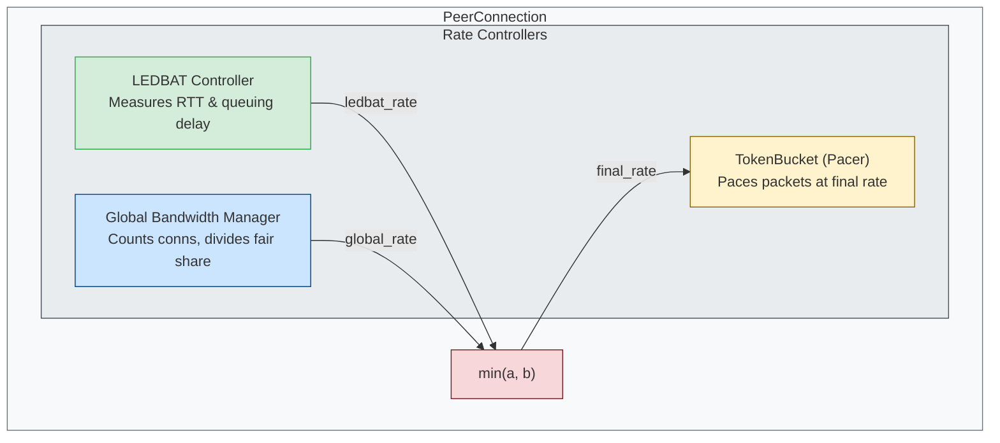

# Transport Bandwidth Configuration

## Overview

The Freenet transport layer supports two bandwidth configuration modes:

1. **Per-connection mode** (default): Each connection gets an independent bandwidth limit
2. **Global pool mode**: Total bandwidth is shared fairly across all connections, and
   `total-bandwidth-limit` is a node-wide cap on everything the node sends

## Quick Start

### Per-Connection Mode (Default)

```bash
# Each connection can use up to 10 MB/s (default)
freenet

# Custom per-connection limit
freenet --bandwidth-limit 5000000  # 5 MB/s per connection
```

### Global Pool Mode (Recommended for bandwidth-constrained environments)

```bash
# Share 50 MB/s total across all connections
freenet --total-bandwidth-limit 50000000 --min-bandwidth-per-connection 1000000
```

## Configuration Options

### CLI Arguments

| Argument | Description | Default |
|----------|-------------|---------|
| `--bandwidth-limit <bytes/sec>` | Per-connection bandwidth limit | 10,000,000 (10 MB/s) |
| `--total-bandwidth-limit <bytes/sec>` | Cap on everything the node sends over UDP, across ALL connections | None (disabled) |
| `--min-bandwidth-per-connection <bytes/sec>` | Minimum per-connection pacing rate inside the total (clamped to the total) | 1,000,000 (1 MB/s) |
| `--congestion-control <algorithm>` | Congestion control algorithm (`fixedrate`, `ledbat`, `bbr`) | `fixedrate` |
| `--ledbat-min-ssthresh <bytes>` | Minimum LEDBAT ssthresh floor (for high-latency paths) | None (~5.7KB algorithm default) |
| `--bbr-startup-rate <bytes/sec>` | BBR initial sending rate (BBR algorithm only) | 25,000,000 (25 MB/s) |

### Config File (TOML)

```toml
[network-api]
# Congestion control algorithm selection
congestion-control = "fixedrate"  # Options: "fixedrate" (default), "ledbat", "bbr"

# Per-connection mode (traditional)
bandwidth-limit = 10000000  # 10 MB/s per connection

# OR Global pool mode (recommended)
total-bandwidth-limit = 50000000           # 50 MB/s total
min-bandwidth-per-connection = 1000000     # 1 MB/s minimum
```

**Note**: If `total-bandwidth-limit` is set, it overrides `bandwidth-limit`.

## LEDBAT Tuning Parameters

### `--ledbat-min-ssthresh` (CRITICAL for High-Latency Paths)

**Purpose:** Sets the minimum slow-start threshold (ssthresh) floor for LEDBAT++ congestion control.

**Default:** None (uses algorithm-derived floor of ~5.7KB per RFC spec)

**Problem Solved:** Without this parameter, LEDBAT++ can become overly conservative on high-latency paths, especially after timeouts. The default behavior causes aggressive cwnd reduction that leads to poor throughput on intercontinental or satellite connections (Issue #2578).

**When to Configure:**
- **Intercontinental connections** (>100ms RTT): 100KB-500KB
- **Satellite links** (>500ms RTT): 500KB-2MB
- **Cross-continent transfers** experiencing timeout storms
- **Symptom:** Slow transfers that never recover speed after initial timeout

**Calculation Guide:**

The ideal value is approximately half of the Bandwidth-Delay Product (BDP):

```
min_ssthresh = BDP / 2
where BDP = bandwidth × RTT
```

**Examples:**

| Link Type | Bandwidth | RTT | BDP | Recommended min_ssthresh |
|-----------|-----------|-----|-----|--------------------------|
| Intercontinental fiber | 10 MB/s | 150ms | 1.5 MB | 750KB (750000) |
| Transpacific | 5 MB/s | 200ms | 1 MB | 500KB (524288) |
| Satellite | 2 MB/s | 600ms | 1.2 MB | 600KB (614400) |
| Local network | 100 MB/s | 10ms | 1 MB | Not needed (default OK) |

**CLI Usage:**

```bash
# Intercontinental (150ms RTT, 10 MB/s)
freenet --ledbat-min-ssthresh 750000

# Satellite link (600ms RTT, 2 MB/s)
freenet --ledbat-min-ssthresh 614400
```

**TOML Configuration:**

```toml
[network-api]
# For high-latency paths
ledbat-min-ssthresh = 524288  # 500KB

# Can combine with bandwidth limits
bandwidth-limit = 10000000
ledbat-min-ssthresh = 750000
```

**How It Works:**

When LEDBAT++ detects congestion or timeout, it reduces cwnd (congestion window). The `ledbat-min-ssthresh` parameter prevents this reduction from going too low, maintaining a minimum throughput floor appropriate for your network path characteristics.

**Reference:**
- Issue #2578 - Timeout storms on high-latency paths
- Code: `crates/core/src/config.rs:805-824`
- Related: `crates/core/src/transport/ledbat/controller.rs` (ssthresh calculation)

---

### `--bbr-startup-rate` (BBR Algorithm Only)

**Purpose:** Sets the initial sending rate for BBR congestion control during the startup phase.

**Default:** 25 MB/s (25,000,000 bytes/sec)

**When to Configure:**
- **CI/Virtualized environments:** Lower to 5-10 MB/s to avoid overwhelming virtualized NICs
- **High-bandwidth production:** Can increase to 50-100 MB/s for faster ramp-up

**Problem Solved:** BBR's aggressive startup can cause "death spiral" in constrained environments where initial packet bursts trigger drops that BBR misinterprets as path capacity.

**CLI Usage:**

```bash
# Conservative for CI/VM
freenet --bbr-startup-rate 5000000  # 5 MB/s

# Aggressive for dedicated hardware
freenet --bbr-startup-rate 50000000  # 50 MB/s
```

**TOML Configuration:**

```toml
[network-api]
bbr-startup-rate = 10000000  # 10 MB/s for moderate startup
```

**Note:** This parameter only affects connections using the BBR algorithm. The default is FixedRate; LEDBAT++ and BBR are opt-in.

**Reference:**
- Code: `crates/core/src/config.rs:838-846`
- Related: `crates/core/src/transport/bbr/` (BBR implementation)

---

## Global Pool Mode Details

When `total-bandwidth-limit` is configured, two things happen.

Each connection is paced at:

```
min_per_connection = min(min-bandwidth-per-connection, total_limit)
per_connection_rate = max(total_limit / active_connections, min_per_connection)
```

And the node-wide egress cap holds the node's total sending rate at `total_limit`,
whatever the per-connection rates add up to (see below).

### Node-wide egress cap

Every datagram the node sends on its UDP socket is charged to one token bucket of
`total_limit` bytes per second: handshakes, ACKs, receipts, keepalive Pings, Pongs,
retransmissions, short messages and stream fragments. The cap counts UDP payload
bytes; IP and UDP headers (28 to 48 bytes per datagram) are not counted. The bucket
holds 25 ms of the rate (at least four 1200-byte packets), so after an idle period the
node may send that much at once before pacing starts. It lives in `DemuxSocket`
(`crates/core/src/transport/demux.rs`) and `crates/core/src/transport/egress_cap.rs`.

Only one kind of send waits for the bucket:

| Send | Behaviour when the bucket is empty |
|------|------------------------------------|
| Stream fragments (`send_stream`, `pipe_stream`) | First reserve the datagram on the per-connection bucket and sleep until it is due, so a connection serves its streams in order; a reservation whose wait would reach the stream's 5 s deadline is not made, so it takes no place in the connection's order, and the stream fails at once (counted as refused, `egress_streams_refused_*`). A reservation that was made and is later given back (the stream is cancelled or fails on a later wait) does not move the fragments behind it up; their waits are not recomputed. An admitted new stream can still delay streams already in progress on the connection, as without a cap; a per-connection scheduler is future work. This looks only at the connection's wait, so a fragment can still fail on the node-wide bucket at the deadline. The fragment keeps that reservation through later waits. Then, right after a cwnd check, take the datagram from the node-wide bucket and send at once. If it is short, take nothing from it, sleep for the deficit times 1.0 to 1.4 plus 0 to 2 ms (random), and start again from the cwnd check. Nothing is held on the node-wide bucket while waiting, and the order among streams waiting for it is random. A stream whose next fragment has not been sent 5 s after its previous one (or after the stream started; the gap the receiver times, whatever the wait was for) fails. |
| Everything else (handshakes, short messages, ACKs, receipts, keepalives, Pongs, retransmissions) | Sent at once and charged once sent. The bucket goes into debt, and the next stream fragments wait longer to pay it. |

The sends that never wait are sent from places that must not block: the receive path
of a connection, which runs inside a `select!` that can be cancelled, the connection's
own task (which sends short messages and also receives for the connection), the
handshake tasks, and the keepalive task. A failed send is not charged.

What this guarantees:

- Over any interval ending at a stream fragment's send, the node sends at most the
  burst plus the cap times the interval, control traffic included, plus the control
  bytes forgiven in that interval: a fragment is sent only when the bucket is not in
  debt.
- Over other intervals the node can send more, by the control-traffic debt not yet
  paid off. That debt is limited to one second of the cap; a control datagram beyond
  it is still sent but not charged ("forgiven", counted as
  `egress_debt_forgiven_bytes`). So the cap holds on average, and forgiven bytes mean
  control traffic alone exceeded the cap for over a second.
- The order among waiting streams is random: a stream that wakes when the bucket has
  room takes it. Each of `N` concurrent streams gets a fragment about every
  `N * 1200 / C` seconds on average at a cap of `C` bytes/s, and the gaps have a
  geometric tail (see the troubleshooting section). Connections share the cap in
  proportion to their number of waiting streams.
- Known limitation: there is no isolation between connections inside the cap. A peer
  that drives many streams through this node gets a proportional share of it.

Without `total-bandwidth-limit` no bucket exists and nothing changes. A
`total-bandwidth-limit` of 0 is ignored with a warning.

At startup the node logs the cap, warns if `min-bandwidth-per-connection` was above
the total (it is clamped), and warns if the total is below 4,800 bytes/s (four
packets) per allowed connection (`max-number-of-connections`), because the control
traffic of a full set of connections can then use most of the cap.

The `transport_snapshot` telemetry event carries, per period: `egress_immediate`,
`egress_waited` and `egress_unpaced` (datagrams by how they were paced),
`egress_bytes`, `egress_bytes_waited`, `egress_wait_us_sum`, `egress_wait_us_max`,
`egress_long_waits_<cause>` (gaps of at least 2.5 s between one stream's fragments,
half the receiver's 5 s stream inactivity timeout), `egress_streams_abandoned_<cause>`
(streams failed at a 5 s gap), `egress_streams_refused_<cause>` (streams failed at
once because their turn on the connection would have come after the 5 s deadline;
`connection` or `other`; `egress_long_waits_*` does not count these, so read the two
together), `egress_debt_hwm_bytes` (the largest control-traffic
debt) and `egress_debt_forgiven_bytes`. `<cause>` is what took most of the gap: `cap`
(sleeping for the node-wide cap), `connection` (sleeping for the connection's own
bucket) or `other` (mostly waiting for the congestion window, or for the upstream stream when the stream is relayed). `egress_waited` and the
wait times count sleeps for either bucket. All are zero without a cap. A gap of 2.5 s or
more between one stream's fragments, and a stream failed at the 5 s deadline, are each
logged at WARN, with separate rate limits (at most once a minute each). A WARN has one
line for each cause that happened since the last one, with its count and remedy.

### Example: 1 Gbps Connection

For a user with 1 Gbps (125 MB/s) wanting Freenet to use 80% of available bandwidth:

```toml
[network-api]
total-bandwidth-limit = 100000000          # 100 MB/s total
min-bandwidth-per-connection = 2000000     # 2 MB/s minimum
```

| Active Connections | Per-Connection Rate | Total Usage |
|-------------------|---------------------|-------------|
| 1 | 100 MB/s | 100 MB/s |
| 5 | 20 MB/s | 100 MB/s |
| 10 | 10 MB/s | 100 MB/s |
| 25 | 4 MB/s | 100 MB/s |
| 50 | 2 MB/s (min enforced) | 100 MB/s |
| 100 | 2 MB/s (min enforced) | 100 MB/s* |

*When `min × connections > total`, each connection may still be paced at the minimum,
but the egress cap holds the node at the total; connections then share it in the
order they send.

### Example: Home DSL Connection

For a user with 50 Mbps (6.25 MB/s) upload wanting conservative bandwidth usage:

```toml
[network-api]
total-bandwidth-limit = 3000000            # 3 MB/s total (~50% of upload)
min-bandwidth-per-connection = 500000      # 500 KB/s minimum
```

## How It Integrates with LEDBAT

The global bandwidth pool works alongside LEDBAT congestion control:

```
final_rate = min(ledbat_rate, global_pool_rate)
```

- **LEDBAT** measures network conditions and adjusts rate to avoid congestion
- **Global pool** enforces your bandwidth budget across all connections
- The **minimum** of both rates is used
- The **egress cap** then holds the sum over all connections at the total

This means:
- If the network is congested, LEDBAT will reduce the rate below the global limit
- If the network is clear, the global limit caps bandwidth to your configured total
- LEDBAT's delay-based feedback is never confused by artificial throttling

## Architecture



## Implementation Details

### Token Bucket

The transport uses a token bucket for smooth packet pacing:

| Parameter | Value |
|-----------|-------|
| Bucket capacity | 10 KB burst |
| Rate | Dynamically adjusted (LEDBAT + global pool) |
| Update frequency | RTT-adaptive (50-500ms) |

### Rate Update Timing

Rates are recalculated on an RTT-adaptive schedule:

| RTT Range | Update Interval |
|-----------|-----------------|
| < 10ms | ~50ms |
| 10-100ms | ~100-200ms |
| > 100ms | ~500ms |

### Connection Lifecycle

1. **Connection established**: `GlobalBandwidthManager::register_connection()` called
2. **During transfer**: Rate updated periodically via `current_per_connection_rate()`
3. **Connection closed**: `RemoteConnection::drop()` calls `unregister_connection()`

## Backward Compatibility

The default behavior (no `total-bandwidth-limit`) is unchanged:
- Each connection gets an independent 10 MB/s limit
- N connections can use up to N × 10 MB/s total
- No egress cap exists

Before the egress cap, `total-bandwidth-limit` only divided a per-connection rate:
`min-bandwidth-per-connection` could take the node above it, and control traffic was
never counted against it.

## Recommendations

### For Gateway Operators

```toml
[network-api]
# Dedicate significant bandwidth to serving the network
total-bandwidth-limit = 100000000          # 100 MB/s
min-bandwidth-per-connection = 1000000     # 1 MB/s minimum
```

### For Regular Peers

```toml
[network-api]
# Conservative settings for residential connections
total-bandwidth-limit = 10000000           # 10 MB/s total
min-bandwidth-per-connection = 500000      # 500 KB/s minimum
```

### For Testing/Development

```toml
[network-api]
# Higher limits for local testing
bandwidth-limit = 100000000                # 100 MB/s per connection
# OR
total-bandwidth-limit = 500000000          # 500 MB/s total
```

## LEDBAT Configuration for High-Latency Paths

### The ssthresh Death Spiral Problem (Issue #2578)

On high-latency paths (>100ms RTT, e.g., US-EU intercontinental), repeated packet
timeouts can cause the slow start threshold (ssthresh) to collapse:

```
After 8 timeouts: ssthresh drops from 1MB → 5KB
Result: Slow start exits immediately, throughput limited to ~300 Kbit/s
```

This manifests as:
- Transfers that should take 2-3 seconds taking 18+ seconds
- Throughput dropping to <500 Kbit/s despite available bandwidth

### Solution: Configure min_ssthresh

Set a minimum floor for ssthresh in `LedbatConfig`:

```rust
LedbatConfig {
    min_ssthresh: Some(100 * 1024),  // 100KB floor
    ..Default::default()
}
```

### Recommended min_ssthresh by Network Type

| Network Type | RTT | min_ssthresh | Example Use Case |
|--------------|-----|--------------|------------------|
| LAN | <10ms | `None` | Local testing |
| Regional | 10-50ms | `None` | Same-country peers |
| Continental | 50-100ms | `Some(50KB)` | Cross-country |
| **Intercontinental** | 100-200ms | **`Some(100KB-500KB)`** | **US-EU, US-Asia** |
| Satellite | 500ms+ | `Some(500KB-2MB)` | Remote/satellite links |

### Gateway Operators

For gateways serving global traffic, configure a higher floor:

```rust
LedbatConfig {
    min_ssthresh: Some(500 * 1024),  // 500KB - good for intercontinental
    ..Default::default()
}
```

---

## Troubleshooting

### Slow transfers despite high bandwidth limit

1. Check LEDBAT is not detecting congestion (high queuing delay)
2. Verify the receiving peer has sufficient bandwidth
3. Check if too many connections are sharing the global pool
4. **For high-latency paths (>100ms RTT):** Configure `min_ssthresh` (see above)

### Connections getting starved

Increase `min-bandwidth-per-connection`:
```bash
freenet --total-bandwidth-limit 50000000 --min-bandwidth-per-connection 2000000
```

### Total bandwidth exceeding limit

The egress cap holds the average at `total-bandwidth-limit`. Short bursts above it
are the unpaced sends (ACKs, retransmissions, handshakes, keepalives, short
messages); check `egress_unpaced`, `egress_debt_hwm_bytes` and
`egress_debt_forgiven_bytes` in the `transport_snapshot` telemetry. Forgiven bytes
mean unpaced traffic alone exceeded the cap for more than a second: raise the total,
or lower `max-number-of-connections`.

### Transfers slow or failing under a low total

If `egress_waited` and `egress_wait_us_sum` are high, streams are waiting for the
egress limits, which is the limits working. If `egress_unpaced` bytes are a large share
of `egress_bytes`, control traffic is using most of the cap; see the startup warning.

Streams fail when a limit is too low for the number of streams waiting on it. A receiver
abandons a stream when 5 s pass between two of its fragments
(`STREAM_INACTIVITY_TIMEOUT`), and with a cap the sender fails a stream whose next
fragment has not been sent 5 s after its previous one (`egress_streams_abandoned_*`; for a
relayed stream the time spent waiting for the upstream stream counts toward the gap from
its second fragment on; the first gap starts when the first upstream chunk arrives).
Two limits can cause it, and the counters and WARN lines say which:

- `cap`: too many streams for the node-wide cap. Raise `total-bandwidth-limit`.
- `connection`: too many streams on one connection for that connection's own bucket,
  which runs at `total-bandwidth-limit / active connections` (at least
  `min-bandwidth-per-connection`). A connection serves its streams' fragments in order,
  so each stream gets one fragment per round of the connection's waiting streams: `N`
  streams on a connection of `C` bytes/s wait about `N * 1200 / C` seconds between
  fragments. Up to about `5 * C / 1200` streams fit in a 5 s round (at 20 KB/s, about
  80); a stream whose turn would come later fails at once (`egress_streams_refused_*`)
  and its operation retries. A new stream can still push one already in progress
  past its turn, as without a cap. That is the same drop-off as before
  the cap existed (when the receiver's 5 s timeout caught those streams), but it fails
  fast. Raise `min-bandwidth-per-connection` (or the total).
- `other`: the time went to the congestion window (slow ACKs), to the upstream stream
  (for relayed streams, from the second fragment on) or elsewhere; the egress settings
  are not the cause.

On a capped node, a stream that reaches the 5 s deadline while it is limited by the
congestion window is counted under `egress_streams_abandoned_*`, not under the existing
cwnd-abort counter (`stream_send_abort_cwnd` in `network_status`). A stream that hits the
3 s cwnd timeout before the deadline is still counted there. `egress_long_waits_other`
also rises with congestion-window waits of 2.5 s or more, whatever the egress limits do.

The 5 s limit also applies to a stream's first fragment, measured from when the stream
started sending (for a relayed stream, from when its first upstream chunk arrived). The
receiver only starts its 5 s timer after the first fragment arrives (before that it waits
up to 60 s for the stream to be claimed), so for the first fragment the sender's limit is
stricter than the receiver's. This is deliberate admission control: a stream that cannot
get a turn within 5 s fails at once and the operation retries, instead of waiting behind
(and delaying) the streams already in progress. A new stream that does get a turn can
still delay the streams already in progress, since it takes a place in the connection's
order ahead of their next fragments.

The node-wide cap is shared by a race, so its risk is per fragment. With `N` streams
waiting on the cap of `C` bytes/s, each
wins a 1200-byte slot with probability about `1/N`, so a gap of more than 5 s has
probability about `p = exp(-5 * C / (1200 * N))` per fragment, and a stream of `k`
fragments fails with probability about `1 - exp(-k * p)`. Here `C` is
`total-bandwidth-limit` and `N` all waiting streams. (A connection's own bucket is not
a race; see `connection` above.)

| `C / N` (bytes/s per waiting stream) | `p` per fragment | 1 000 fragments (1.2 MB) | 10 000 (12 MB) | 47 000 (56 MB) |
|---|---|---|---|---|
| 480 (mean gap 2.5 s) | 0.14 | almost certain | almost certain | almost certain |
| 2 400 | 4.5e-5 | 4.4% | 36% | 88% |
| 2 800 | 8.6e-6 | 0.85% | 8.2% | 33% |
| 3 600 | 3.1e-7 | 0.03% | 0.3% | 1.4% |
| 4 800 | 2.1e-9 | under 0.001% | under 0.01% | 0.01% |

So keep at least about 2 800 bytes/s per waiting stream for streams of up to a few
hundred fragments, and about 4 000 bytes/s per waiting stream for streams of tens of
megabytes. These are estimates from the slot-lottery model, not guarantees. The fix
is a higher limit; there is no per-stream admission control.

A slow stream also holds broadcast capacity: the broadcast queue keeps a send's slot
until its stream completes, up to `STREAM_COMPLETION_TIMEOUT` (120 s), so a cap that
makes streams slow also slows contract update fan-out.

## Source Code

- **GlobalBandwidthManager**: `crates/core/src/transport/global_bandwidth.rs`
- **Egress cap**: `crates/core/src/transport/egress_cap.rs`, charged in `crates/core/src/transport/demux.rs`
- **TokenBucket**: `crates/core/src/transport/token_bucket.rs`
- **LEDBAT**: `crates/core/src/transport/ledbat.rs`
- **Configuration**: `crates/core/src/config.rs`

## References

- [LEDBAT++ Implementation](../design/ledbat-plus-plus.md)
- [RFC 6817: LEDBAT](https://tools.ietf.org/html/rfc6817)
